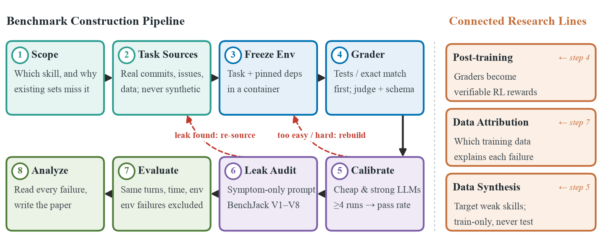
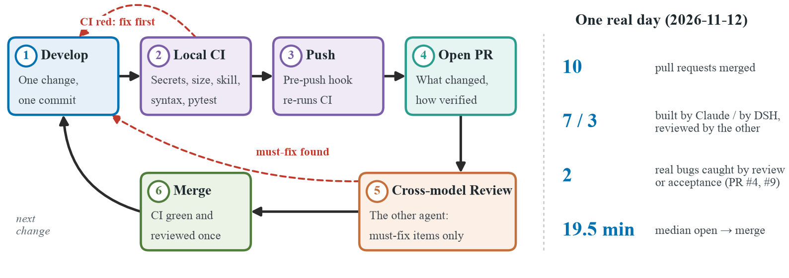
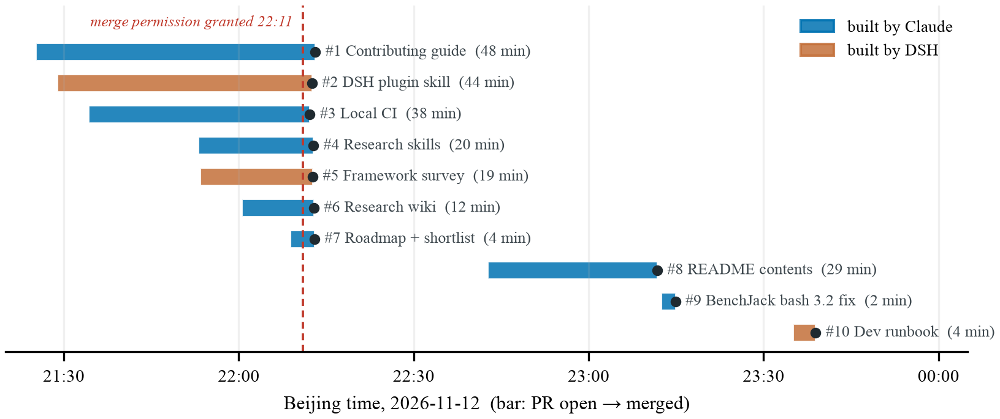
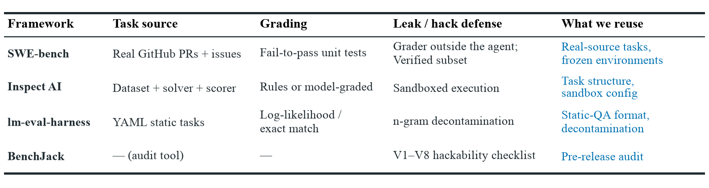
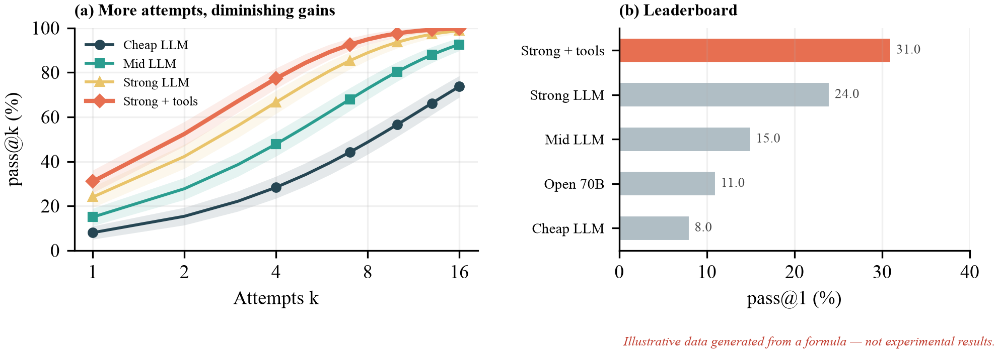

# 论文图

每张图一个脚本，输出到 `out/`（矢量 PDF 放进论文，PNG 用于预览）。字体 Times New Roman，宽度按 ICML 全宽 6.75 英寸，配色与 `.claude/skills/academic-plotting` 一致。

```sh
cd figures
../../.venv/bin/python gen_fig_pipeline.py      # 需要 matplotlib；本机用 ~/Benchmark_Research/.venv
```

| 脚本 | 图 | 数据来源 |
|---|---|---|
| `gen_fig_pipeline.py` | 八步 benchmark 搭建流程 + 三条辅线（示意图） | docs/roadmap.md |
| `gen_fig_collab_loop.py` | 开发 → CI → PR → 换模型审 → 合并循环，右侧当天统计 | 2026-11-12 的真实 PR 数据 |
| `gen_fig_pr_timeline.py` | 10 个 PR 从开到合的时间线 | `gh pr list`，真实数据 |
| `gen_fig_frameworks_table.py` | 框架对比表：预览图 + 可直接 `\input` 的 LaTeX（`out/tab_frameworks.tex`） | docs/benchmark-frameworks.md |
| `gen_fig_results_demo.py` | pass@k 曲线 + 排行榜的版式示范 | **示意数据**，图内已标注，有真实结果后替换 |







公共样式在 `style.py`：`card()` 画带编号的圆角卡片，`arrow()` 画箭头（可加白底标签），阶段色见 `STAGE`。画示意图时，坐标按 100 个单位宽来算，1 个单位约 4.9pt。
